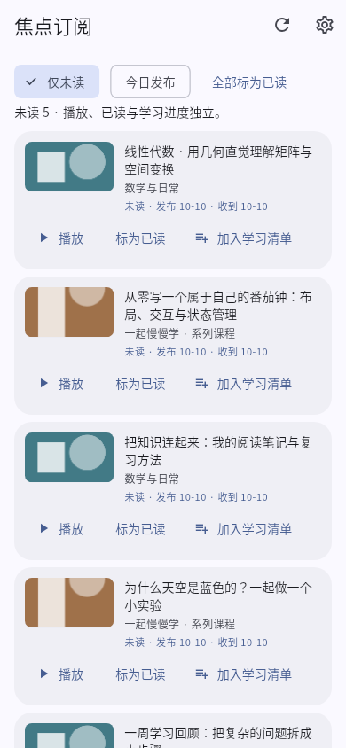
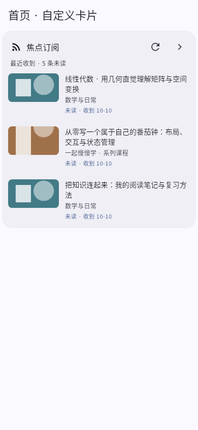
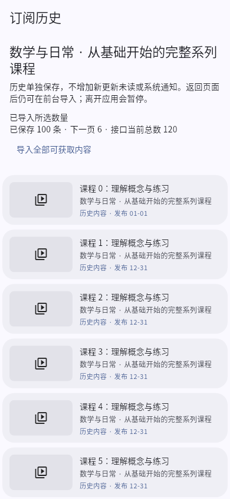

# 1.8.0 Beta4：轻量订阅与独立历史导入

本轮重新 fetch 后，dev 仍为 `dcb9368f7cb905b6d2723eb72a2912081d2775df`，master 为 `9156ad90060d156095bc5484d5fe372fac26fa94`。Beta1/Beta2 已在 dev；唯一开放 PR 为 draft #49，头部 `8341bd9`。独立分支 `codex/beta4-subscription-jobs` 基于该头部，完整保留 Beta3 的紧凑列表、首页自定义卡片、缓存优化及双击反馈修复。没有合并、正式发布或删除分支。

## 改动

- UP 主初次订阅读取最近两页即可开始检查新视频；不再自动拉取全部历史。旧稿不进入实时未读或系统通知。历史内容可在“订阅源设置 → 历史内容”中单独导入最近 100 条或全部可获取内容。
- 普通 UP 检查以两整页已覆盖内容及发布时间边界结束，不能因首页一个置顶旧稿而提前停止。分轮补抓保留游标；续抓检查首页和上一页，首页变化后再做覆盖检查，避免多页新增造成遗漏。合集仍分批遍历，展示最近完整核对时间，不把首页无变化或总数相同当成全量无变化。
- 移除本地第 50 页静默钳制，使用实际请求页码。对响应页码错误、重复页、空页仍声称有后续的情况停止并展示范围受限，不假装全量完成。100000 页为显式本地安全上限，超出会报错，不重复最后一页。
- WBI 签名材料复用已有小时缓存；风控回退前使缓存失效。实际订阅 HTTP 开始时间至少间隔一秒；前后台共享持久网络租约，保留来源并发上限 2、原 CAS、后台时间预算、退避和通知持久去重。超时、暂停及离开前台会取消底层客户端；晚到结果仍经过代际/来源/所有者校验。
- 历史任务与实时去重、提醒记录分离。每页元数据先以不可变目录原子发布，再提交任务游标；中断后复用已保存页。过期任务不能覆盖新任务已保存的页。暂停、继续、数量上限、重试退避及旧任务等待时间在页面可见。已保存历史支持分页显示和播放跳转。
- 旧 v1 快照非破坏迁移到 v2；保留迁移前原文、旧 partial pending、已读和通知声明。未来版本拒绝写入；损坏数据保留隔离副本并恢复有效备份。写备份失败不会误判为损坏后退回旧数据。
- 新增历史页继续使用左封面右文字，兼容 320px、大字号、桌面深色。首页卡片仍从同一个订阅服务取最近推送，不增加轮询。历史页等待重试仅在截止时间安排一次 UI 更新。

## 性能证据

同一 Linux 环境、Flutter 3.44.6 / Dart 3.12.2，dev 独立 worktree 与本分支运行相同 `subscription_paging_probe_test.dart`。真实 HTTP 适配器、签名器和订阅扫描器串联，网络层返回可控 JSON 夹具；没有连接真实 B 站或读取账号。

| 来源条数 | 首轮 HTTP（前 → 后） | 首轮内容页（前 → 后） | 四轮 HTTP（前 → 后） | 四轮后初始化（前 → 后） |
|---|---:|---:|---:|---|
| 100 | 10 → 3 | 5 → 2 | 22 → 9 | 完成 → 完成轻量基线 |
| 1,000 | 40 → 3 | 20 → 2 | 108 → 9 | 完成 → 完成轻量基线 |
| 10,000 | 40 → 3 | 20 → 2 | 166 → 9 | 未完成，反复第50页 → 完成轻量基线 |

“后”不宣称完成全部历史：实时基线只记 40 条，历史任务按用户选择另外请求。显式导入 10,000 条的组合测试请求 500 个内容页（包含第 51 和第 500 页），复用基线已经取得的签名材料，没有新增 nav 请求，没有新更新未读或通知。真实服务是否允许这种深度尚未验证；接口限制将停下并保留已获得内容。

[原始请求计数：dev](paging-before.json) · [Beta4](paging-after.json)。

```sh
flutter test --no-pub --dart-define=PAGING_OUTPUT=/tmp/paging.json test/subscription_paging_probe_test.dart
```

在 dev worktree 复制相同测试及 `test/support/subscription_public_pages.dart` 后执行同一命令。其余缓存/组件创建计数沿用同一个 [Beta3 探针](../beta3/README.md)，Beta4 复测记录为 [performance-after.json](performance-after.json)。

## 验证与截图

最终本地检查：

- 完整 `flutter test --no-pub`：821 通过、1 项原有字体依赖跳过、0 失败（首轮仅版本号断言仍为 Beta3，修正后完整重跑通过）。
- 定向订阅/后台/CAS/迁移/历史页面/HTTP取消/播放器/版本回归：84 通过、0 失败；截图与性能专用运行另有 8 项通过。
- `flutter analyze --no-pub`、`dart format --output=none --set-exit-if-changed lib test`、`git diff --check` 通过。
- Android JVM：9 suites、35 项通过、0 失败/错误/跳过；本地三 ABI debug 包构建成功（JVM 未变任务使用 Gradle 缓存，CI 将在独立 runner 再检查）。
- 只读代码审查未发现可证明的实时数据丢失、重复通知或不可变页覆盖。进程释放后的旧 owner 可能保留最多 90 秒；界面显示最迟可继续时间，并在截止时更新按钮，不抢占有效的跨实例任务。
- 既有 Windows CI 额外运行历史文件恢复及 HTTP 取消测试，再构建原生 debug；远端结果以 draft PR 的 Actions 为准。

[结构化本地核验记录](validation.json)。截图命令：

```sh
flutter test --no-pub --dart-define=BETA3_CAPTURE_DIR=/tmp/beta4-ui test/subscription_compact_ui_test.dart test/subscription_history_page_test.dart test/support/beta3_player_capture.dart
```

截图是生产 Flutter 页面/组件的真实测试引擎渲染，数据、封面及播放后端使用夹具，不是真机截图或设计稿。

| 紧凑更新列表 | 首页订阅卡片 | 独立历史导入 |
|---|---|---|
|  |  |  |

[320px / 180% 字号](history-large-text.png) · [桌面深色历史](history-desktop-dark.png) · [桌面来源管理](sources-desktop-dark.png) · [宽屏双击反馈](player-desktop-forward.png)

## 限制与安装兼容

- 未在真实 B 站账号/接口、Android 设备或 Windows 主机进行端到端验收。Linux widget、Windows CI widget 和原生编译均不能替代 Windows 视频播放真机验收。双击动画修复依据为 Beta3 实测的宽屏偏移 293.5px，相关连续双击、方向切换、缩放、重播回归本轮继续运行。
- 合集及实时变化的分页列表没有服务端快照承诺，排序变化可能影响历史覆盖。导入到达接口返回末页不等于服务端保证完整历史。轻量基线对缺失/异常发布时间的陌生旧稿保持安静；不将全部未见旧稿批量推送。
- 页元数据已经独立持久化；精确 BV 索引、签名索引及实时 seen 集合仍在快照中。超大长期集合的 JSON 写入成本仍在，归一化索引数据库属于后续工作；没有将模拟耗时外推成耗电承诺。
- 沿用包名与签名配置；共享版本 `1.8.0+24`、debug `-beta.4`。仅检查配置是否存在与 APK 公开证书，不读取、生成或上传签名秘密。不同签名或更低 versionCode 不能覆盖现有安装，不要靠无备份卸载解决。
- 任务迁移保留原始 v1 数据，但老版本不识别 v2。请先保留数据备份，不将降级视为已验证的恢复方式。


本地 ARM64 已构建：`FocuBili-1.8.0-beta.4-preview-arm64.apk`，包名 `com.focubili.app.preview`，versionCode `2024`。公开证书仍为 `5bd1fc4daa8a0887e213c4dc1231d0eba4f7f309a0e64c2d15fe404302bd00b0`，与本环境旧 ARM64 Beta2/Beta3 相同；未验证用户设备当前安装证书。[本地 APK hash / 证书记录](apk-verification.json)。环境未配置 `android/key.properties`。既有 CI 通用包的 code 是 `24` 且沿用临时 debug 签名，不能保证覆盖历史包；实际 CI 产物需看其随包 `apk-verification.json`。
