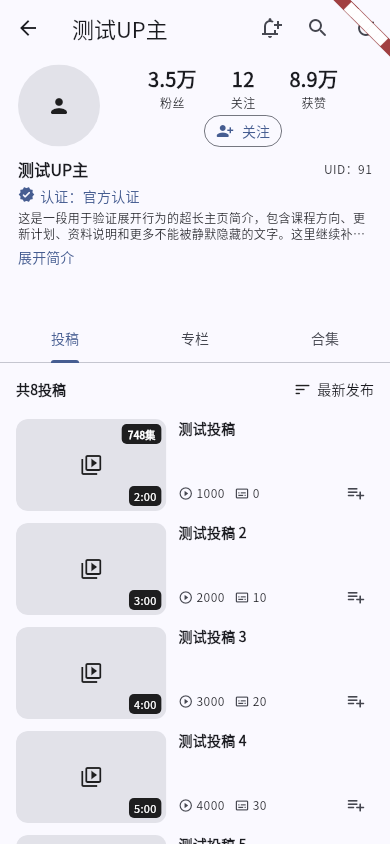
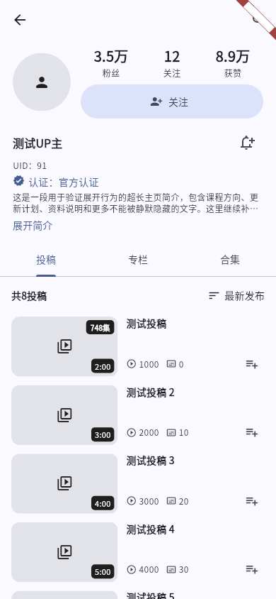

# UP 主页：关注、搜索与添加订阅源

<table><tr><th>原来（beta.4）</th><th>现在</th></tr><tr><td></td><td></td></tr></table>

- 在 390×844dp 的真实路由上，关注按钮从约 78×32dp 扩至 258×48dp，与统计栏左右对齐。保留关注、取消关注及处理中防连点。参见[大字](large.png)与[桌面](desktop.png)。
- 顶栏默认只提供投稿搜索动作，不显示搜索框。点击后[展开输入框](search.png)，提交只查该 UP 的投稿。关键词、排序与分页结果均拒绝被迟到的旧响应替换。删除本页右上的刷新，原下拉刷新及错误重试仍可用。
- 资料旁的订阅图标直接打开[添加通知设置](notifications.png)，不再二次确认来源。通知开关控制所有焦点订阅，不是针对单个作者；取消不写入，保存时才申请所选系统权限。拒绝后仍可选择只看应用内更新。手工添加来源、合集与取消订阅保持原流程。

截图是生产 Flutter 控件和中文字体渲染，使用合成资料及示例视频，搜索键盘图用模拟键盘占位。回归涵盖真点击、查询顺序、资料随列表收起及通知拒绝/失败，不是实体设备、真实账号、原生权限面板或读屏器的端到端验证。

```sh
flutter test --no-pub test/creator_header_notifications_test.dart test/profile_collection_pages_test.dart
flutter analyze --no-pub
```
