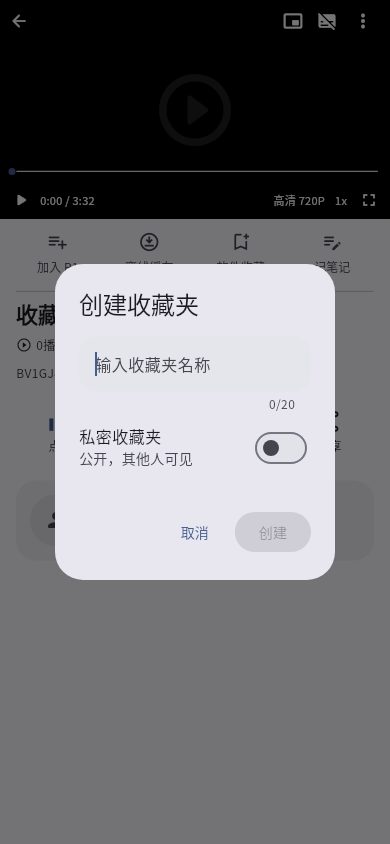
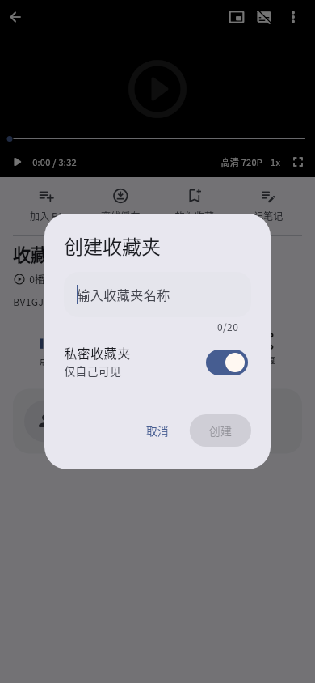

# 新建 B 站收藏夹的可见性

播放器 → 收藏 → 新建收藏夹。「私密收藏夹」默认关闭，和旧版创建公开收藏夹的行为相同。打开后明确显示“仅自己可见”；取消不会创建，也不会在下次打开时沿用上一次未提交的选择。本机收藏夹不使用此设置，已有远端收藏夹也不会被修改可见性。

| 默认公开 | 用户选择私密 |
| --- | --- |
|  |  |

截图来自实际 Flutter 播放页（390 × 844，自制数据）。测试检查了确认、取消和重开；接口测试通过原有 POST 请求编码器记录请求正文：公开为 `privacy=0`、私密为 `privacy=1`，特殊字符标题正确编码。失败不会改为公开重试。账号切换或视频已改变时，不继续提交旧弹窗的收藏目标。没有向真实账号创建收藏夹，不将本地编码回归说成 B 站线上可见性验收。
