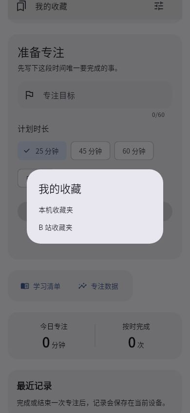
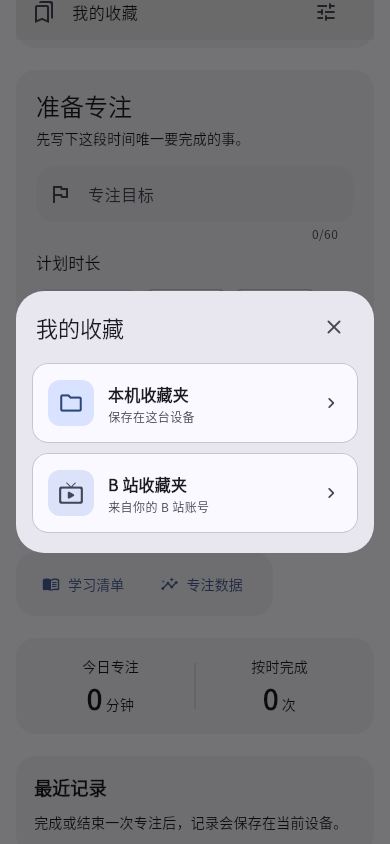
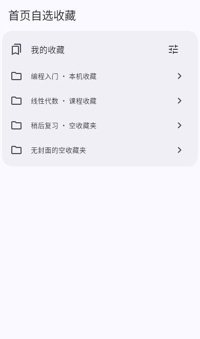
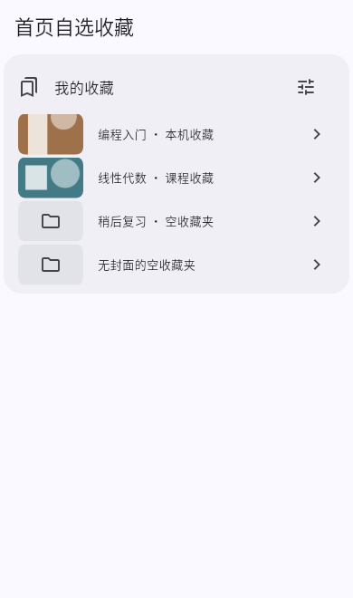

# 首页 · 我的收藏

## 选择收藏来源

<table><tr><th>beta.4</th><th>本次改动</th></tr><tr><td></td><td></td></tr></table>

390×844 竖屏下，弹窗从 280×152dp 增至 358×262dp；两项原本各高 36dp，现在各为 326×80dp，点整行都有效。文件夹表示本机，电视表示 B 站。关闭、遮罩、Esc 和系统返回都不默选。普通字号下显示来源说明；[320×480、240% 字号](picker-large-text.png)时让出装饰空间给完整名称，不缩小用户字体。[宽屏](picker-desktop.png)上弹窗宽度不超过 480dp，支持 Tab 选择、Enter 打开。

## 从封面认出已选收藏夹

<table><tr><th>beta.4</th><th>本次改动</th></tr><tr><td></td><td></td></tr></table>

- 本机夹从最近收藏的视频里取第一张非空封面。新增或移除视频后，留在首页的卡片也会更新。
- B 站夹先用夹自身的封面；已选、有内容但没有自定义封面的夹，用第一页中第一个可用视频的封面。没有选中的夹不为此加载视频。[深色示例](folders-dark.png)里，从上到下分别是本机夹、B 站自定义夹、从视频补图的默认夹。
- 无图、失效或加载失败时仍能从原入口打开。封面不另设朗读焦点，文件夹名称及原有点按操作保留。不把远端封面地址写入首页配置，切号时也不沿用旧账号在途结果。

本机空夹列表、B 站未登录 / 读取错误共用的说明页，在[高度不足](local-landscape.png)时可以滚到原来的“新建”或“重试”，正常大小仍居中。

## 验证边界

这些图来自 Flutter 3.44.6 运行的实际生产组件，使用中文字体、测试收藏数据与示例封面。回归用例实点弹窗按钮边缘、取消、键盘与系统返回，并覆盖本机变更、封面缺失、慢请求跨账号及短横屏空态。这不是实体设备、真实 B 站账号/CDN 或系统读屏器的端到端验证。

```sh
flutter test --no-pub test/home_favorite_source_dialog_test.dart test/home_favorite_covers_test.dart test/favorite_empty_layout_test.dart test/home_collection_card_test.dart test/home_collection_offline_test.dart
flutter analyze --no-pub
```
