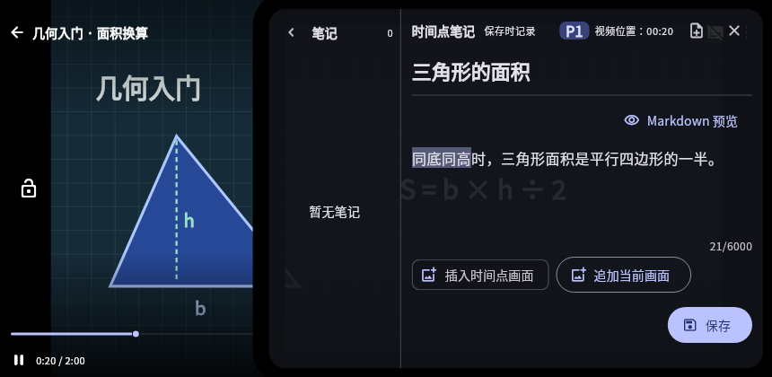
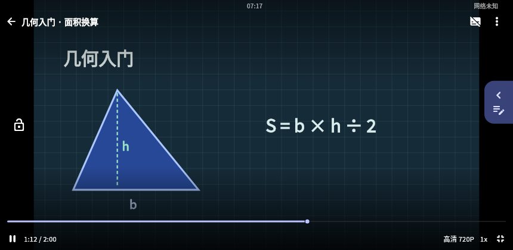
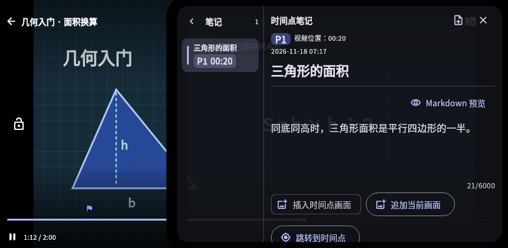

# 横屏播放器：停靠时间点笔记

基线：`8245c6b`（`dev`）。这里的播放器窗口、控件、笔记编辑区来自实际 `PlayerPage`；视频画面、笔记正文和播放事件均是合成测试数据，没有真实账号或媒体。

- 横屏打开时间点笔记，点击面板外的画面或进度条只将笔记滑到右边，不触发播放或跳转。面板一开始滑出，外部拦截层就移除，可以马上拖进度、横滑或使用播放键。
- 点击右侧带笔图标的把手继续原稿。保留正文、选区、编辑器滚动位置、撤销历史和笔记原时间点；拖动视频进度不改写笔记时间点。折叠状态下只有把手在辅助功能树中，编辑器不占用焦点，也没有透明点击区。
- 桌面可用 Escape 停靠、Space 激活聚焦的把手；键盘隐藏后不会抢回编辑焦点。切回竖屏继续在视频下方编辑；退出全屏但仍横屏时保留停靠状态；返回键先关闭笔记，再退出全屏。
- 不改笔记存储、视频时间轴和截图捕获的工作方式。真离开时仍会落盘等待去抖的草稿。

## 实际前后

使用同一个 `860 × 420` 的 Flutter 播放器和位置 `00:20` 的草稿。基线点外侧进度条时发出一次 `seekTo(00:17.196)`，笔记仍盖在视频上。[基线截图](before-after-outside.png)

| 打开笔记 | 停靠后拖动进度 | 展开继续 |
| --- | --- | --- |
|  |  |  |

[窗口工作台的停靠效果](04-workspace-parked.png) 使用 `1024 × 560`、`140%` 文字缩放。短横屏用例使用 `542 × 300`、`200%` 文字、`19dp` 右侧安全区和 `155dp` 键盘遮挡：恢复回到停靠前的编辑滚动位置，按 Ctrl+Z 仍只撤销最后的输入。测试也覆盖键盘把手、竖屏、全屏退出、系统返回和待保存草稿随播放器卸载落盘。

## 复现

```sh
flutter pub get --offline --enforce-lockfile
flutter test -j1 --no-pub test/player_landscape_note_peek_test.dart
```

生成 PNG 可加 `--dart-define=FOCUBILI_NOTE_PEEK_EVIDENCE=/absolute/path`；有需要时用 `FOCUBILI_NOTE_PEEK_CJK_FONT` 和 `FOCUBILI_NOTE_PEEK_ICONS_FONT` 指定 Noto Sans CJK 与 Flutter Material Icons 字体路径。

**未覆盖：** 实机旋转/系统导航手势、原生输入法组合和实际 VoiceOver/TalkBack。测试使用 Flutter 窗口尺寸变化、键盘安全区和语义树，以及可记录操作的模拟播放后端，不是视频解码或系统级跑验。
