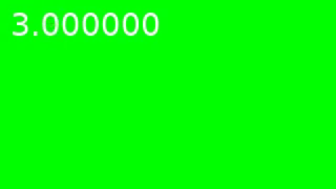

# 播放中给时间点笔记追加当前画面

播放时打开一条旧笔记，点击「追加画面」。附件应取**当前正在显示的画面**，而不是旧笔记的时间点。笔记原有时间点不变，视频也不应为截图暂停、跳转或重新加载。

## 回归对照

- 在原版的真实 Flutter 播放页面上，播放到 01:15 时向 00:42 的笔记追加一帧，独立的播放后端记录到 1 次暂停、2 次跳转和 1 次恢复播放。没有观察到重开视频；这不排除实际在线流因跳转而缓冲。
- 同一操作在候选版没有发出额外的暂停、跳转、播放或打开视频指令。旧笔记仍锚定 00:42，附件时间是画面回读期间的 01:15.125，而不是点击时的 01:15.000。
- 下图来自自行生成并烧录时间码的六秒 FFmpeg 视频。将 1、3、5 秒画面依次送进实际 PlayerPage 内容区，经生产 Flutter 画面回读保存了 3 秒的绿色画面，附件为 00:03.000，随后播放位置到达第 5 秒。此测试未使用原生解码器。
- 开发回归 35 项与既有交互 4 项通过；覆盖回读失败、晚到回包、切换来源、用户删除及离开编辑器。自动化测试中的播放器并不会模拟所有设备或网络产生的缓冲。

## 平台范围

Android 读取当前 Surface 的 PixelCopy 缓冲区；其他原生平台使用现有 Flutter 合成画面读回。两者都不跳转到旧笔记时间点，不用 B 站缩略图替代截图。在源已改变、尚无可复制帧、媒体声明受保护、系统拒绝读回或结果不可信时，不追加图片，仍保留文字及已有附件。刻意保存某个历史时间点的其他操作不在本次更改范围。

平台未提供被复制缓冲区的解码帧时间戳。附件时间是回读前后播放时钟的中点；读回耗时或播放位置变化超过 350 毫秒、倒退或跨源将拒绝保存。此门槛不是帧级精度保证。未在真实 Android 硬件解码 Surface、Apple 设备或桌面 GPU 上验收。不同硬件纹理可能无法读回；不会为补救而重播或跳转。
