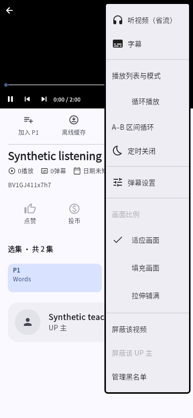
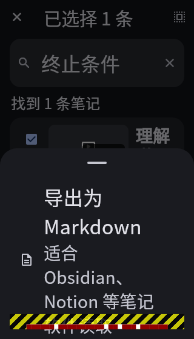
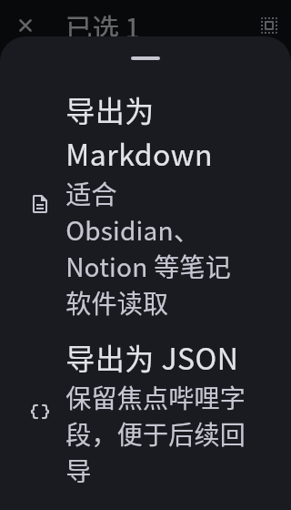

# 从找到视频到复习笔记

本次在 `dev@e89b140` 上逐屏检查“首页 → 搜索 → 观看”和“我的 → 时间点笔记 → 复习 / 导出”。保留专注首页的留白，不增加卡片、动效或第二个设置入口。改动集中在搜索、播放器菜单和笔记管理。截图是生产 Flutter 组件当次运行的画面，使用示例数据、中文字体和可控的本机服务，不是设计稿或实机照片。

## 1. 找到视频

[首页](home.png)保留单一搜索主操作。[搜索结果](search-result.png)里的三个点仍是 18dp 小图标，但命中区从 40×40 调到 Material 的 48×48dp。密集结果行中，点在菜单左上角内 2dp 只打开菜单，不误开视频；按 Esc 可关闭，键盘可连续打开两次。标题仍用于打开视频。图上不能判断触达区，因此另有实际边缘点击和几何断言。

## 2. 在观看中找到工具

<table><tr><th>原来</th><th>现在</th></tr><tr><td></td><td></td></tr></table>

“更多”先列听视频和字幕，再列播放列表、循环和定时。屏蔽与黑名单管理仍在底部单独一组。实际打开字幕后返回、进出听视频、滚动到屏蔽并撤销、Esc / 系统返回和重复打开；没有改动播放后端。黑色视频区域是模拟后端没有视频纹理，不代表真实视频黑屏。

## 3. 从列表认出要复习的笔记

<table><tr><th>320×560，200% 字号：原来</th><th>同一条笔记：现在</th></tr><tr><td></td><td></td></tr></table>

原布局给封面固定 132×74dp，文字栏也固定高 74dp；此夹具中多张卡片向下溢出 125dp。现在优先呈现标题和正文，时间点、视频名和记录时间随后；有来源封面时显示在来源旁，缺封面时不重复占位。搜索正文时，结果直接显示[关键词及前后文](notes-search.png)，无需逐条打开确认。从详情返回保留筛选。另见[手机浅色](notes-phone.png)和[桌面深色双列](notes-desktop.png)。

独审还复现了慢封面的数据丢失：先编辑正文或删除无封面笔记，再放行旧查询，旧列表会把整条记录写回来。现按最新本机数据只补空封面字段，不覆盖正文、画面和编辑时间，不新增记录。补图与编辑、删除共享写入顺序；取图或补图失败可继续读笔记。

## 4. 导出看得见的选择

<table><tr><th>大字时原格式菜单溢出</th><th>同尺寸下可滚动的格式选择</th></tr><tr><td></td><td></td></tr></table>

更改筛选后，已隐藏的笔记不会被带进导出或分享；清空筛选不会偷偷重选它们。取消另存仍保留当前选择。窄屏大字缩短底部按钮文字，但保留完整无障碍名称。桌面 Esc、系统返回或关闭键先离开选择模式，不直接退掉笔记页。已在 320×480、240% 字号和模拟键盘下核对搜索无结果可恢复，并滚动实点最后一个 JSON 格式。

## 5. 保留已有入口

检查了[个人中心](profile.png)和[设置首屏](settings.png)的明暗主题与 200% 字号。个人入口已有自定义排序，原有回归明确不提供重复的顶栏设置按钮；设置页已有分类和搜索。本次两处不改。

## 可复现的验证

Flutter 3.44.6，生产控件配测试用笔记、播放器及本机选择器。真实另存 / 系统分享、原生输入法、TalkBack / VoiceOver、真实 B 站网络和设备逐帧性能未作结论。

```sh
flutter test --no-pub test/search_video_row_interaction_test.dart test/player_more_menu_test.dart test/video_notes_review_flow_test.dart test/video_notes_page_test.dart test/video_note_service_test.dart
flutter analyze --no-pub
```
